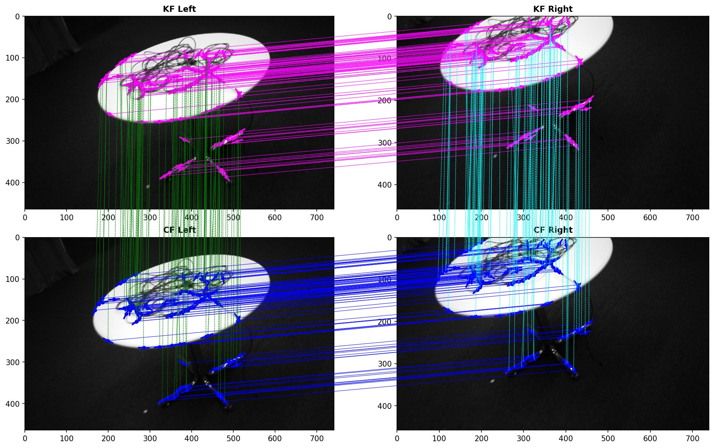

# GPU-Based Edge Feature Matching on Stereo Images
## Research @ LEMS, Brown University
This repository is home to the GPU implementation that constructs edge correspondences from _(i)_ a stereo image pair and _(ii)_ from temporal stereo images to arrive at quadtiplet edge correspondences (or "quads"), aiming to address the super slow computation time from the CPU implementation. This is one of the building blocks of [QuadEdge-VO](https://github.com/Brown-LEMS/Edge_Based_Visual_Odometry), a visual odometry framework using edge quads. Thus, in our temporal edge matching, we often say it construct edge correspondences between a "key (stereo) frame (KF)" and the "current (stereo) frame (CF)".

Note that this code **does not** require a rectified stereo image pair, nor needs to have the same image resolution for left and right cameras. This is the case in the ETH3D-SLAM dataset, and we use is as a demonstration here. Below is an example of two stereo images from ETH3D SLAM benchmark `cables_2` sequence. The unrectified left and right image sizes are `742x464` and `739x458`. Each edge is presented as a location (point) an an orientation (line at the point), and the connections are the correspondences. 100 quads out of 8170 quads are randomly selected for visualization.



The runtime of edge matching across a stereo image pair and temporal stereo images vary by the image size, number of detected edges, candidate matches, _etc_, but in general, when running the CPU version using 32-core and NVIDIA GeForce RTX 3090 GPU, the GPU version gives around 100x speedup.

## Dependencies
Running on both CPU and GPU requires the following libraries/packages:
* Eigen 3.X or beyond
* OpenCV 4.X (with contrib is optional)
* [yaml-cpp](https://github.com/jbeder/yaml-cpp) (used to parse data from the dataset config file)
* CUDA (tested on version 12.9)
* glog or boost (Optional)

## How to use the code
### Build and Compile
Follow the standard build and compilation, namely, 
```bash
mkdir build && cd build
cmake ..
make -j
```
You shall find executive files under the ``bin`` folder. Note that CUDA sources are compiled when `ENABLE_CUDA` is on (`src/CMakeLists.txt`), linked against `CUDA::cudart` with separable compilation.

For Brown University users, a shell script `load_oscars_modules.sh` is provided so a simple command `$ source ./load_oscars_modules.sh` would automatically load all the necessary modules to build the code.

### Execute
Run the execution file `main_edge_matching` with a specified YAML configuration file:
```bash
./bin/main_edge_matching --config_file ./config/your-config-file.yaml
```
where the configuration file ``your-config-file.yaml`` can be customized depending on the dataset in use. See ``.yaml`` files under the ``config`` folder for more information. <br />

## Overview of GPU Implemented Edge Correspondences

Basically, there are four sequental stages:
| Stage | Role |
|-------|------|
| **Third-Order Edge Detector** | Detect accurate third-order edges (oriented points) on the stereo image pair |
| **Preparation** | Set up geometry and images on the GPU for the current stereo pair |
| **Stereo** | Match left edges to right edges within one stereo frame |
| **Temporal** | Match keyframe stereo mates to current-frame stereo mates across time |

The third-order edge detector is borrowed from my [another GitHub repository](https://github.com/C-H-Chien/Third-Order-Edge-Detector). In the process of stereo and temporal edge matching, several GPU parallel strategies are adopted:
- Undistroted stereo images are cached as CUDA textures for fast, subpixel intensity sampling. The same texutres are reused over the time when applicable.
- The geometric filters, photometric filters, and refinement as well as consolidation are basically one kernel per filter/step, if otherwise specified. In each kernel, one thread is assigned either per left edge, or per candidate mate, depending on the process. For example, in epipolar rasterization for geometric filtering, one thread is allocated per left edge, while in the NCC/SIFT filter for photometric filtering, one thread is allocated per one candidate match. 
- *Thrust* handles on-device sorting, prefix scans, and compaction, _e.g._, grouping edges by spatial-grid cell (`sort_by_key`), segmenting refined hypotheses per left edge before merge/clustering, and picking one final stereo mate per left edge.

Optional host-side export (`retrieve_stereo_mates`, `retrieve_final_matches`, output files) is used for logging and visualization; the hot path can stay entirely on the device between stereo and temporal steps.

## Example
Run the ETH3D dataset SLAM banchmark sequence `cables_2` by
```bash
./bin/main_edge_matching --config_file ./config/eth3d_slam.yaml
```
and the output quads will be written into a file located under the `outputs/` folder. You can visualize the quads by running the python code `visualization/visualize_quads.py`. To generate the figure shown above, use the following command:
```bash
export seq=path/to/ETH3D/slam/cables_2/
python3 visualize_quads.py --kf-left ${seq}/rgb2/11873.252219.png --kf-right ${seq}/rgb/11873.252219.png --cf-left ${seq}/rgb2/11873.289083.png --cf-right ${seq}/rgb/11873.289083.png 
```
